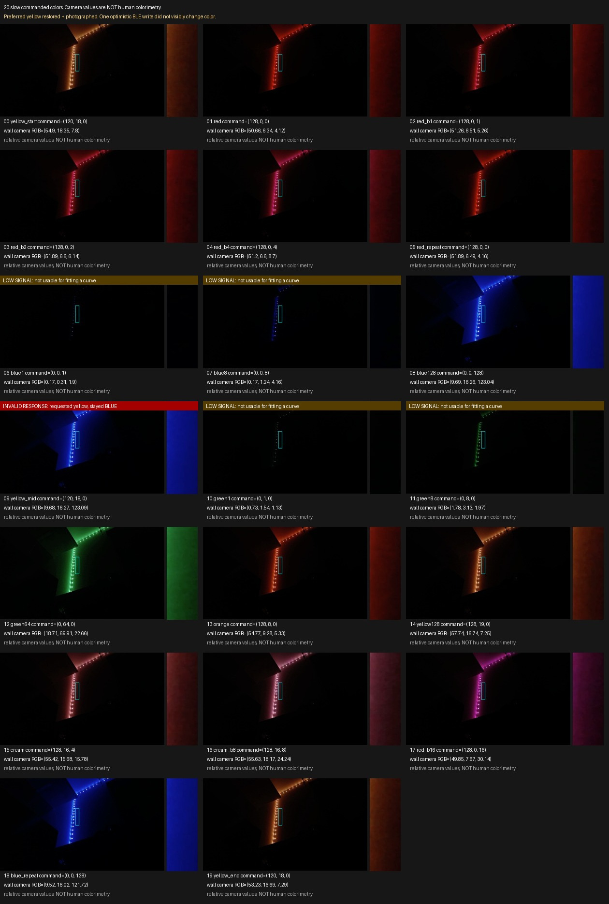

# bringing cheap bluetooth leds into apple home

i wanted to control my led strip from Apple Home.

not replace the strip. not buy another controller. not open the thing and start soldering. just use the lights i already had, without having to open their app every time.

this sounded like a small weekend project. which is usually how these things start lying to me.

the result is [Iris](https://github.com/GustavoWidman/iris): an ESP32-S3 bridge between Matter over Wi-Fi and the Bluetooth controller already attached to my strip. the original controller stays, the IR remote stays, and i get to change the lights from Home.

i built and debugged this with my assistant. it helped with firmware, protocol investigation, tests, and tooling; i provided the hardware and the extremely scientific feedback of "that looks green" and "why is red pink now". mostly, we checked assumptions against an actual wall.

## a bridge, not a replacement

the controller advertises itself as `BJ_LED`, and its phone app is MohuanLED. Iris talks to that controller over BLE rather than replacing its job of driving the strip.

```text title="the whole arrangement"
Apple Home
    | Matter over Wi-Fi
    v
ESP32-S3 running Iris
    | BLE commands
    v
existing BJ_LED controller
    |
    v
existing led strip
```

the firmware uses ESP-IDF and ESP-Matter to present a Matter color light and translate Home's commands. the repo documents the tested ESP32-S3 setup and pairing requirements. i wanted my lights in Home, not a compatibility certification program.

## seven bytes, several assumptions

the RGB command for this controller looks wonderfully boring:

```text title="RGB frame"
69 96 05 02 R G B
```

three color bytes, wrapped in a short frame. send red, get red. surely the hard part is over.

red did work. mixtures had other plans.

"the command worked" could mean the conversion was right, the packet had the intended bytes, the controller changed its output, or the wall looked right. those are NOT the same question.

there was a real conversion bug in the XY-to-RGB path, and that was fixed separately. but fixing the math didn't fix every physical color. i'd already seen weird mixing through the original phone app, before the bridge existed.

that distinction mattered. otherwise we'd spend the evening "fixing Matter" for behavior that the controller already had.

we added an exact-RGB diagnostic path that bypasses correction, separating conversion from output. some observations from my strip:

- `(128,0,0)` looked like a good deep red.
- `(128,8,0)` looked like a rich orange.
- `(120,18,0)` became my preferred yellow at that tested brightness.
- very small blue additions to red could look surprisingly pink.
- `(128,16,4)` looked like creamy white.

not a measured transfer function, or a guarantee that scaling the numbers would preserve the appearance. still, more useful than "the purple is wrong".

## the webcam was not a colorimeter

at some point i connected a Logitech C930e to the Mac and pointed it at the wall. if a human was getting tired of describing colors, surely a camera could take over.

after sorting out macOS permissions, we locked exposure, focus, and white balance so the camera wouldn't compensate for each swatch. we sampled reflected wall light, not the clipped white dots of the LEDs: 20 slow swatches in about two minutes, then restored my preferred yellow and the camera settings.



one yellow command reported a successful BLE write while the wall still showed the preceding blue. we excluded that sample rather than politely asking the spreadsheet to believe the log. the cause wasn't established; the low-signal samples weren't usable for fitting either.

the camera also called my preferred yellow orange. to my eyes, it was bright yellow. fixed settings made comparisons more repeatable, not colorimetrically accurate. the camera helped catch output failures; it did not get to overrule what i was looking at.

## a correction, not a calibration

i still wanted something usable from Home, rather than a collection of RGB numbers to type manually.

the final experiment leaves red alone and progressively attenuates green and blue when red is present. pure primaries and the entire red-zero plane, including cyan, stay unchanged. before rounding to bytes:

```text title="experimental red-context balance"
peak = max(R, G, B)
if peak == 0: return (0, 0, 0)

red_context = R / peak
R_out = R
G_out = G * (1 - 0.85 * red_context)
B_out = B * (1 - 0.96875 * red_context)
```

the implementation uses integer arithmetic with explicit rounding; the strengths are heuristic choices based on the swatches above.

| requested RGB   | corrected RGB |
| --------------- | ------------- |
| `(120,120,0)`   | `(120,18,0)`  |
| `(128,128,128)` | `(128,19,4)`  |
| `(128,0,0)`     | `(128,0,0)`   |
| `(0,128,128)`   | `(0,128,128)` |

an earlier version normalized back to the original peak. it preserved pure blue, but adding one code of red could turn `(0,0,32)` into `(32,0,32)`.

technically a function. emotionally a jump scare.

another version avoided that jump but dimmed cyan heavily, without evidence that cyan needed fixing. rejected too.

the final version was checked over all 16,777,216 byte RGB inputs and more than 100 million neighboring transitions. no channel amplification, unchanged red-zero plane, and no output-channel step larger than one for a one-code input change. host suites passed with GCC, Clang, and undefined-behavior sanitization.

those are numerical guarantees, not proof that every color looks right. mixtures with red can lose peak code; perceived brightness is another problem.

it's opt-in. identity remains the default in the public source, and exact-RGB diagnostics still bypass it.

## pretty damn good is a useful stopping point

we built the experimental firmware and flashed only the app partition, keeping the Apple Home pairing and a neutral app rollback. Wi-Fi, Matter, and BLE came back. then i tried it through Home, where the correction actually runs, rather than judging the diagnostic override.

my verdict: "it's not perfect, but it's pretty damn good."

one board, one controller, one strip, and one person's eyes: not universal calibration, but lights i actually like using.

[Iris is on GitHub](https://github.com/GustavoWidman/iris), with protocol notes, setup instructions, the opt-in profile, and host tests. the published correction is in [`49044d1`](https://github.com/GustavoWidman/iris/commit/49044d1b9e6924f175cde3f9b28479e94e315b04), and both GCC and Clang CI passed. private pairing data and rollback images aren't in the repo.

i started with "can i turn my lights on from Home?" and ended up debugging the difference between a successful Bluetooth write and a yellow wall.

at least i can turn the lights on from Home now.
